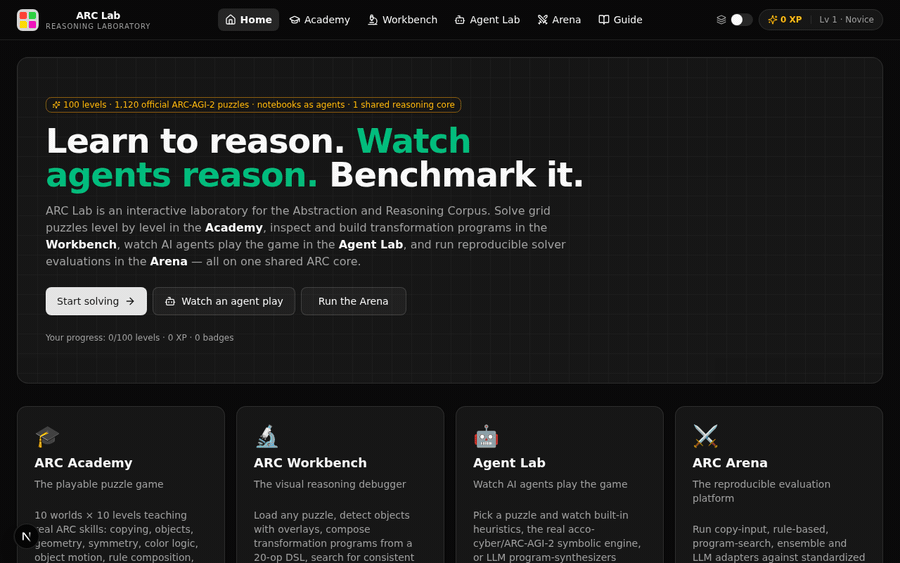
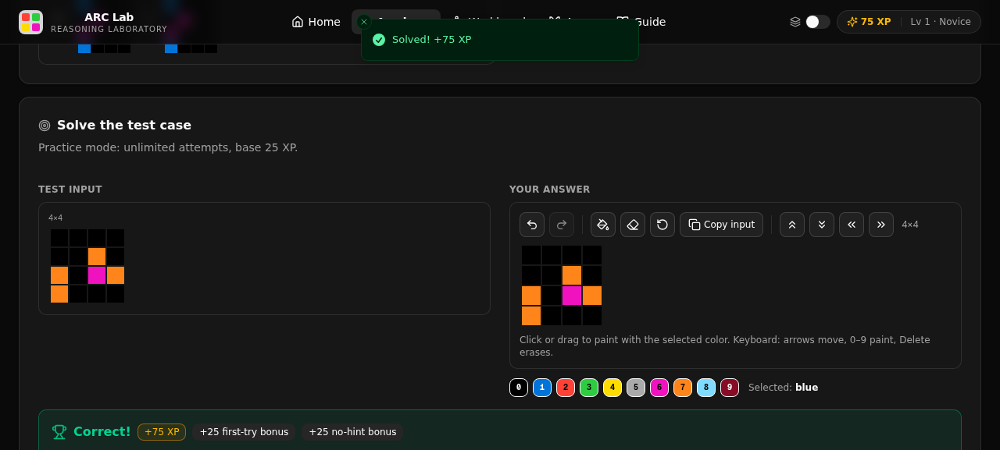
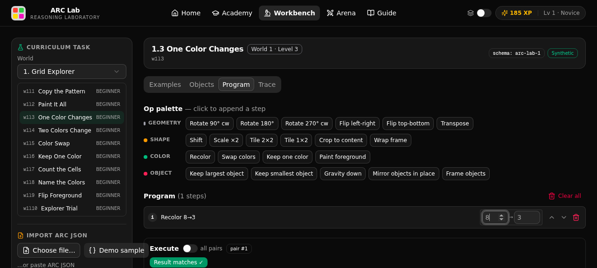
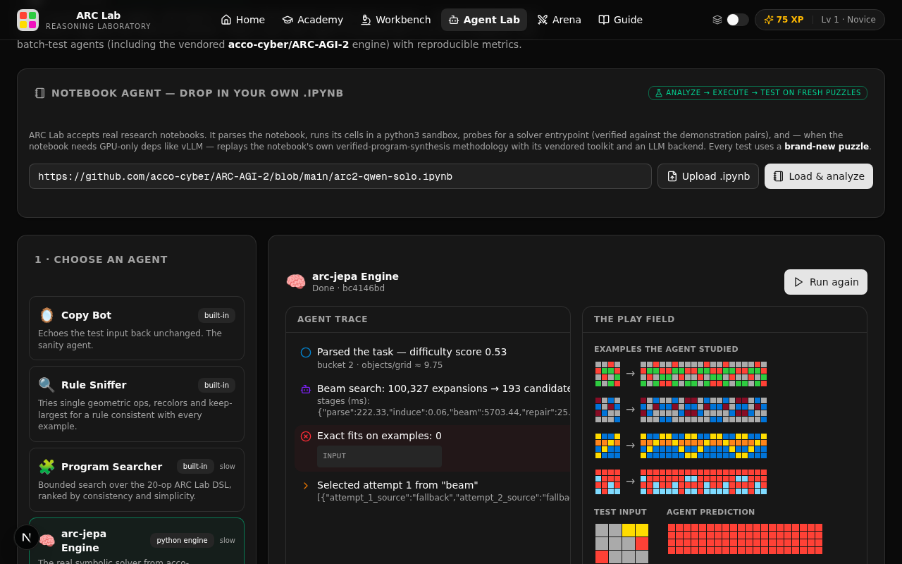
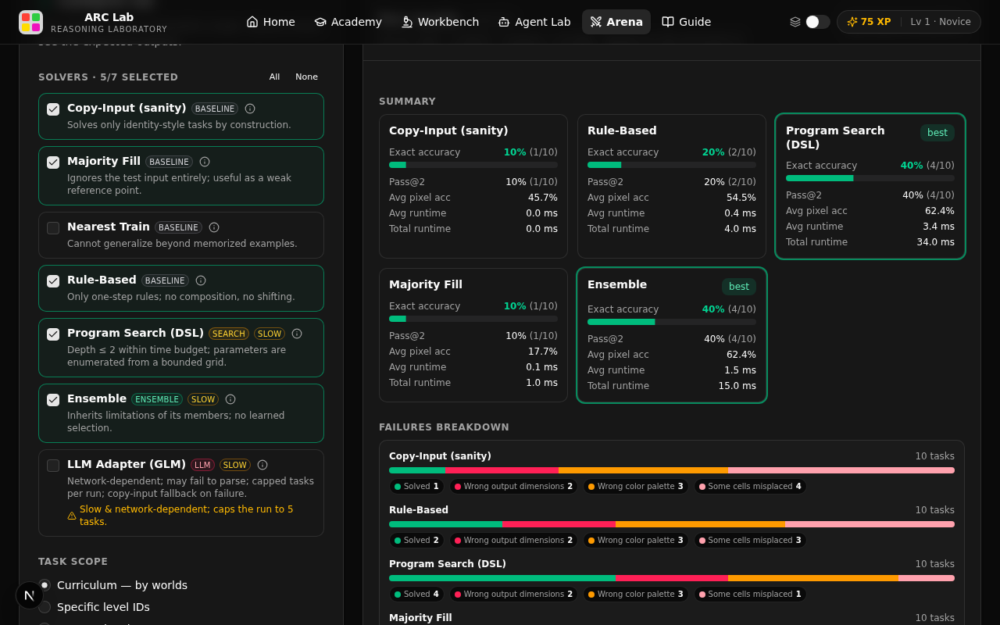

<div align="center">

# 🧩 ARC Lab

**Interactive abstract reasoning laboratory — for humans and for machines.**

[](https://huggingface.co/spaces/koushikz1/ARC-Lab)
[](LICENSE)
[](package.json)
[](CONTRIBUTING.md)

**▶ [Try the live demo](https://huggingface.co/spaces/koushikz1/ARC-Lab) — no install, no account.**

```bash
bun install && bun run db:push && bun run dev   # local: http://localhost:3000
```

**▶ [Watch the 15-second launch demo (video)](docs/videos/launch-demo.mp4)**



</div>

## The signature workflow

Most ARC tools do one thing. ARC Lab connects the whole reasoning loop around **the same puzzle**:

1. **Solve it yourself** — play the puzzle in the [Academy](#-academy--learn-by-solving) with a real grid editor and tiered hints.
2. **Build the rule** — open *the same puzzle* in the [Workbench](#-workbench--debug-the-reasoning) and construct/verify a transformation program step by step.
3. **Watch AI attempt it** — run any of 7+ agents — including a real notebook like [`arc2-qwen-solo.ipynb`](https://github.com/acco-cyber/ARC-AGI-2) — in the [Agent Lab](#-agent-lab--watch-agents-play) on **a fresh official ARC-AGI-2 puzzle** it has never seen.
4. **Compare the results** — score everything with the same metrics in the [Arena](#-arena--reproducible-evaluation), inspect failure modes, export the run as JSON.

Every experience shares one TypeScript ARC core, so a puzzle moves between them without translation loss.

| | |
|---|---|
|  |  |
| *Academy — solve, get scored, earn XP* | *Workbench — build the rule, verify it fits every example* |
|  |  |
| *Agent Lab — watch an agent reason, then score it* | *Arena — compare solvers, inspect failure taxonomy* |

## Verified results (reproducible)

**All numbers below were measured in this repository, on CPU only (no GPU), with expected test outputs hidden from solvers until after prediction.**

### Vendored acco-cyber/ARC-AGI-2 engine (`arc-jepa`), deterministic 12-task curriculum sample

Reproduce: `bun run scripts/batch-engine-test.ts` · methodology & per-task programs in [docs/AGENT-ENGINE-REPORT.md](docs/AGENT-ENGINE-REPORT.md)

| Metric | Result |
|---|---|
| Exact task accuracy | **10 / 12 (83.3%)** |
| Pass@2 | 10 / 12 |
| Avg pixel accuracy | 94.2% |
| Avg runtime | 4.76 s/task (single CPU core, symbolic mode) |

Every solved task had a DSL program that reproduces **all** demonstration pairs — verified before the test prediction was committed.

### Built-in Arena baselines, representative run (10 curriculum tasks, all 10 worlds)

Reproduce: open **Arena** → select solvers → *Run evaluation* → *Export run JSON* (the export lists exact task ids, solver set, dataset version and timestamp).

| Solver | Exact acc | Pass@2 | Avg pixel acc | Avg runtime |
|---|---|---|---|---|
| Copy-Input *(sanity)* | 10% | 10% | 45.7% | 0.0 ms |
| Majority Fill | 10% | 10% | 17.7% | 0.1 ms |
| Rule-Based | 20% | 20% | 54.5% | 0.4 ms |
| Program Search (DSL, depth ≤ 2) | **40%** | **40%** | 62.4% | 3.4 ms |
| Ensemble | **40%** | **40%** | 62.4% | 1.5 ms |

### Honest limitations — read before citing

- The tables above are on the **synthetic curriculum** (`arc-lab-curriculum-v1`), not the official ARC evaluation sets. Curriculum tasks are easier than official ARC-AGI-2 tasks.
- On **official ARC-AGI-2 training tasks** (fresh, never-seen), single runs of these small CPU agents mostly **fail** — e.g. the `arc-jepa` engine scored 18.8% pixel accuracy / not solved on task `bc4146bd` (10.7 s). ARC Lab reports failures with the same rigor as successes.
- The LLM-based agents require an available LLM backend; without one they degrade to a documented fallback (copy-input / unverified candidates are labeled as such).
- No number here should be cited as an ARC-AGI-2 benchmark score. For that, run the official evaluation on the semi-private sets with [ARC Prize](https://arcprize.org) tooling.

## Quick start

```bash
git clone https://github.com/acco-cyber/ARC-Lab.git
cd ARC-Lab
bun install          # or: npm install
bun run db:push      # creates the local SQLite database (Prisma)
bun run dev          # http://localhost:3000
```

No authentication, no external services, no paid APIs required. Progress is stored locally (anonymous player id + SQLite). Verified on a clean clone with Bun 1.2 and Node 20+.

## The four experiences

### 🎓 Academy — learn by solving
- **10 worlds teach real skills**: Grid Explorer → Shape Detective → Spatial Wizard → Pattern Hunter → Color Logic → Object Engineer → Rule Composer → Context Master → Program Detective → ARC Grandmaster.
- **100 procedurally generated levels** (deterministic per seed — answers are correct by construction).
- **Real grid editor**: click/drag painting, resize, fill, undo/redo, copy-input, full keyboard support.
- **Tiered hints**: (1) "what changed?" → (2) transformation clue → (3) worked explanation. Hints reduce XP.
- **Two modes**: Challenge (2 attempts, full XP) and Practice (unlimited). The answer is **never sent to the browser** while you attempt — the server hides it until submission.
- **Progression**: XP, 18 badges, daily streaks, per-world skill map, deterministic daily puzzle, hand-off buttons ("Open in Workbench / Run in Arena").

### 🔬 Workbench — debug the reasoning
- Inspect every demonstration pair; connected-component object detection with overlays (presented as *heuristic*).
- **20-op DSL program builder** with live execution and **consistency checking across all examples**.
- **Bounded program search**: iterative-deepening enumeration, pruned on demonstrations only — **structurally blind to the test output**.
- **Step trace**: execute a program op-by-op with changed-cell highlighting to find exactly where a rule diverges.
- **Import/export**: native ARC JSON (ARC-AGI-1/2 files load as-is; unknown fields preserved for ARC-AGI-3 forward compatibility).

> The UI enforces one scientific rule everywhere: **fitting the examples is not the same as solving the test case.**

### 🤖 Agent Lab — watch agents play
- **📓 Notebook agent** — drop in a real `.ipynb` by URL or upload. ARC Lab analyzes it (cells, imports, pip installs, GPU-only deps, `%%writefile` modules, entrypoints), **executes its code cells in an isolated sandbox**, probes for a solver function (verified against the examples), and — when the notebook needs GPU-only deps like vLLM — **replays the notebook's own methodology** (verified program synthesis with its vendored toolkit, LLM backend substituted). Prefilled with [acco-cyber/ARC-AGI-2](https://github.com/acco-cyber/ARC-AGI-2)'s `arc2-qwen-solo.ipynb`. See [SECURITY.md](SECURITY.md) for the isolation model.
- **Official ARC-AGI-2 puzzles — always fresh**: the complete public set (1,000 training + 120 public evaluation tasks) is vendored under Apache-2.0 — the same public data as the Kaggle ARC Prize 2026 competition and arcprize.org. The server **never serves the same puzzle twice** to the same agent (history resettable); expected answers stay server-side until the agent commits, then are revealed with the score.
- **arc-jepa Engine** — the actual symbolic solver from acco-cyber/ARC-AGI-2 (induction → typed-DSL beam search → verification → repair → A* → evolution), vendored in `engine/arcjepa/`, CPU mode (torch optional). [Measured results](docs/AGENT-ENGINE-REPORT.md): 10/12 exact, 94.2% pixel, 4.8 s avg.
- **APEX-style synthesizer, LLM reasoner, custom JS agent (Web-Worker sandboxed), HTTP endpoint agents** — all scored with the same protocol.
- **Batch tests + scoreboard** with per-agent persistence.

### ⚔️ Arena — reproducible evaluation
- **7 built-in solvers** (copy-input, majority-fill, nearest-train, rule-based, DSL program search, ensemble, LLM adapter) — each with documented behavior when dependencies or API access are unavailable (see the ⓘ panel in the UI).
- **Metrics**: exact match (primary), pass@2, pixel accuracy (diagnostic), per-task & total runtime, **failure taxonomy** (no-prediction / shape-mismatch / color-palette / misplaced-cells).
- **Reproducibility**: every run persists dataset version, solver set, scope, timestamp and app version; exports as JSON. The evaluator **never exposes expected test outputs before prediction** — solutions are stored server-side and revealed only after commit.

## Trust & safety

- **Notebook sandbox**: untrusted notebook code runs with (1) network egress blocked via a user/network namespace when the OS allows (`unshare -rn`), (2) a stripped environment — **no credentials or secrets are inherited**, (3) CPU/memory/file-size/process limits (`RLIMIT_CPU`, `RLIMIT_AS`, `RLIMIT_NPROC`, `RLIMIT_FSIZE`), (4) wall-clock + output caps, (5) a throwaway working directory. Honest trade-offs (subprocess ≠ VM) are documented in [SECURITY.md](SECURITY.md).
- **No answer leakage**: the Academy serves attempts without answers; Workbench search prunes only on demonstrations; Agent Lab/Arena score server-side after commit.
- **Dataset hygiene**: the game curriculum is fully synthetic — human play cannot contaminate official-benchmark interpretation. [Full policy](#dataset--licensing-policy).
- Found a security issue? Please report it — [SECURITY.md](SECURITY.md).

## ARC-AGI-1 / ARC-AGI-2 / ARC-AGI-3 compatibility

- The task schema accepts standard ARC JSON (`{train:[{input,output}],test:[{input,output?}]}`) with any `schema_version` and preserves unknown extra fields — ARC-AGI-1/2-era files load as-is, and the same tolerance keeps ARC Lab ready for ARC-AGI-3's evolving formats.
- All grid semantics (transforms, object detection, comparison) live in one TypeScript core shared by the game, the debugger and the solvers — no TS/Python dual-implementation drift.

## Dataset & licensing policy

- The Academy curriculum is **fully original and synthetic** (`arc-lab-curriculum-v1`), generated deterministically from per-level seeds — the game never reuses official tasks.
- The Agent Lab (and Workbench loader) additionally vendors the **complete public ARC-AGI-2 set** (1,000 training + 120 public evaluation tasks, `data/arc-agi-2/`, provenance in [`data/arc-agi-2/SOURCE.md`](data/arc-agi-2/SOURCE.md)) under the upstream Apache-2.0 license. The semi-private and fully-private competition sets are not public and are not included.
- You can import official or third-party ARC JSON into the Workbench and Arena yourself; imports stay local to your session and are clearly labeled.

## Architecture

```
src/
├── app/
│   ├── page.tsx                  # single user-visible route
│   └── api/                      # REST API (puzzles, progress, daily, agent, official, arena)
├── components/
│   ├── arc/                      # shared grid primitives (view, editor, palette, pair)
│   ├── academy/  workbench/  arena/  agent/
│   └── arc-lab/                  # app shell, providers, home, guide
└── lib/
    ├── arc/                      # THE SHARED CORE
    │   ├── types.ts grid.ts transforms.ts objects.ts colors.ts rng.ts
    │   ├── dsl.ts                # 20-op DSL + bounded program search
    │   ├── solvers.ts metrics.ts progress.ts
    │   └── curriculum/           # 100-level deterministic generator
    ├── server/                   # API helpers, official-task queue, notebook runner, llm
    └── store/ client/
engine/arcjepa/                   # vendored symbolic solver (acco-cyber/ARC-AGI-2), torch optional
data/arc-agi-2/                   # vendored public ARC-AGI-2 tasks (Apache-2.0)
scripts/batch-engine-test.ts      # reproducible engine evaluation
prisma/schema.prisma              # Player, LevelProgress, DailyResult, ArenaRun, AgentPuzzleRun
```

**Stack**: Next.js 16 (App Router) · TypeScript · Tailwind CSS 4 · shadcn/ui · Prisma (SQLite) · TanStack Query · zustand · optional z-ai-web-dev-sdk (LLM agents, backend only).

Why a single TypeScript core instead of the classic TS-web + Python-engine split? Keeping grid semantics **identical** across the game, the debugger and the evaluation harness is the highest-value invariant in an ARC tool. External Python solvers participate through the documented HTTP agent contract (`{train, testInputs} → {attempts|prediction}`).

## Contributing

Contributions are welcome — see [CONTRIBUTING.md](CONTRIBUTING.md) for setup, conventions and good first issues. Please read our [Code of Conduct](CODE_OF_CONDUCT.md).

## Roadmap

- Solver plugin registry + external runner docs, replay viewer for human traces, puzzle authoring/sharing, leaderboards, neural adapters (ARC-JEPA-style), ablation reports.
- See the in-app **Guide** tab for the full dataset policy and scoring rules.

## License

MIT — see [LICENSE](LICENSE).
