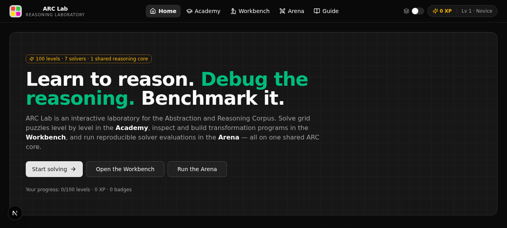
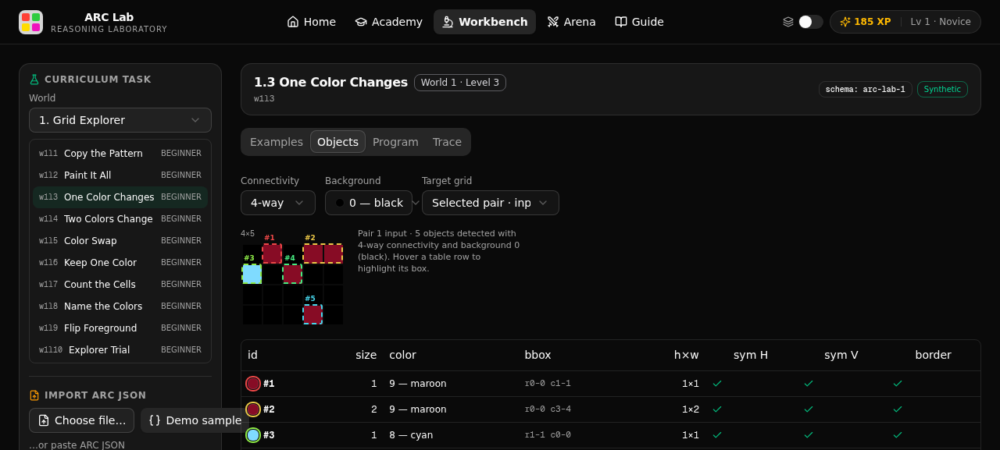

# ARC Lab — Interactive Abstract Reasoning Laboratory

<p align="center">
  <em>Learn to reason. Debug the reasoning. Benchmark it.</em>
</p>

ARC Lab is one integrated product with three experiences built on a **single shared ARC core** (grid representation, validation, transformations — one TypeScript implementation everywhere):

| Experience | What it is | Who it's for |
|---|---|---|
| 🎓 **ARC Academy** | A 100-level hands-on puzzle game (10 worlds × 10 levels) with an interactive grid editor, tiered hints, XP/badges, daily challenges and progress tracking | Beginners — no ML background required |
| 🔬 **ARC Workbench** | A visual reasoning debugger: example inspector, object detection with overlays, a 20-op DSL program builder, bounded program search, and step-by-step execution traces | Researchers & puzzle hunters |
| ⚔️ **ARC Arena** | A reproducible evaluation platform: 7 baseline solvers (symbolic, search, ensemble, LLM) with exact accuracy, pass@2, pixel accuracy, runtime and a failure taxonomy | Solver developers |

**The integration is the point.** A puzzle solved by hand in the Academy can be opened in the Workbench to construct the rule as a program, and the same task can be run through symbolic, search-based and LLM solvers in the Arena — so you can compare your human reasoning trace with the machines'.

<p align="center">
  
</p>

## Screenshots

| Academy (game) | Workbench (object inspector) |
|---|---|
|  |  |

| Workbench (program builder) | Arena (evaluation) |
|---|---|
|  |  |

## Quick start

```bash
bun install
bun run db:push      # create the SQLite database (Prisma)
bun run dev          # http://localhost:3000
```

Or with npm/pnpm: `npm install && npx prisma db push && npm run dev`.

No authentication, no external services. Progress is stored locally (anonymous player id + SQLite). The optional **LLM Adapter** solver uses the z-ai-web-dev-sdk when available and degrades gracefully to a copy-input fallback where it isn't.

## The three experiences

### 🎓 Academy — learn by solving

- **10 worlds teach real skills**: Grid Explorer → Shape Detective → Spatial Wizard → Pattern Hunter → Color Logic → Object Engineer → Rule Composer → Context Master → Program Detective → ARC Grandmaster.
- **100 procedurally generated levels** (dataset `arc-lab-curriculum-v1`): every puzzle's ground truth is computed by applying the intended transformation, so answers are correct by construction and fully deterministic per seed.
- **Real grid editor**: click/drag painting, resize, fill, undo/redo, copy-input, full keyboard support (arrows + 0–9 + Delete).
- **Tiered hints**: (1) "what changed?" → (2) transformation clue → (3) worked explanation. Hints reduce XP — honest learning over hand-holding.
- **Two modes**: Challenge (2 attempts, like the ARC two-guess convention, full XP) and Practice (unlimited, base XP). The answer is never shown while you are attempting — the server hides it until submission.
- **Progression**: levels unlock sequentially; worlds unlock after 5 solves in the previous world. XP, 18 badges, daily streaks and a per-world skill map.
- **Daily puzzle**: one new deterministic challenge per day (Asia/Dhaka), shareable and streak-tracked.
- **Accessibility**: keyboard navigation, ARIA labels on every cell, and a color-blind-friendly pattern overlay toggle in the header.

### 🔬 Workbench — debug the reasoning

- **Examples**: inspect every demonstration pair side by side.
- **Objects**: connected-component detection (4/8-connectivity), bounding-box overlays with per-object properties (size, color, bbox, symmetry, border contact). Detections are presented as *heuristic*, never as ground truth.
- **Program**: compose ops from a 20-op DSL (rotate, flip, transpose, shift, scale, tile, crop, frame, recolor, swap, keep-color, paint, keep-largest/smallest, gravity, mirror-in-place, frame-objects), execute on demonstrations, and check **consistency across all pairs**.
- **Bounded search**: iterative-deepening enumeration over the DSL, pruned on the first demonstration, ranked by consistency + simplicity + pixel accuracy. Deterministic and blind to the test output.
- **Trace**: step through the program operation by operation with changed-cell highlighting — see exactly where a candidate rule diverges.
- **Import/export**: native ARC JSON (ARC-AGI-1/2 files load directly; unknown fields preserved for forward compatibility with future schema versions).

> Scientific rule enforced in the UI: **a program that fits the demonstration examples has not necessarily discovered the intended rule.** The Workbench distinguishes "fits the examples" from "solves the test case" everywhere it reports results.

### ⚔️ Arena — reproducible evaluation

Built-in baselines (each with documented limitations):

| Solver | Kind | Notes |
|---|---|---|
| Copy-Input | baseline | Sanity check for the pipeline |
| Majority Fill | baseline | Modal train output shape/color |
| Nearest Train | baseline | Memorization reference point |
| Rule-Based | baseline | Single geo op / recolor / keep-largest |
| Program Search (DSL) | search | Bounded 20-op DSL, depth ≤ 2 |
| Ensemble | ensemble | Deterministic selection over members |
| LLM Adapter (GLM) | llm | Two JSON samples for pass@2; graceful fallback |

Metrics reported (official-style scoring kept strictly separate from diagnostics):

- **Exact task accuracy** — primary metric
- **Pass@2** — either of two candidates matches
- **Pixel accuracy** — diagnostic only
- **Runtime** — wall-clock per task and total
- **Failure taxonomy** — no-prediction / shape-mismatch / color-mismatch / cell-errors
- **Reproducibility** — every run persists dataset version, solver set, scope, timestamp and app version, and exports as JSON

## ARC-AGI-1 / ARC-AGI-2 / ARC-AGI-3 compatibility

- The task schema accepts the standard ARC JSON (`{train:[{input,output}],test:[{input,output?}]}`) with any `schema_version` string and preserves unknown extra fields — ARC-AGI-1/2-era files load as-is, and the same tolerance keeps ARC Lab ready for ARC-AGI-3's evolving formats.
- All grid semantics (transforms, object detection, comparison) live in one TypeScript core shared by the game, the debugger and the solvers — no TS/Python dual-implementation drift.

## Dataset & licensing policy

- The Academy curriculum is **fully original and synthetic** (`arc-lab-curriculum-v1`), generated deterministically from per-level seeds. No official ARC evaluation tasks are redistributed or used in the game, so human exposure cannot contaminate benchmark interpretation.
- You can import official or third-party ARC JSON files into the Workbench and Arena yourself; imported tasks stay local to your session and are clearly labeled as user imports.

## Architecture

```
src/
├── app/
│   ├── page.tsx                  # single user-visible route
│   └── api/                      # REST API (puzzles, progress, daily, arena)
├── components/
│   ├── arc/                      # shared grid primitives (view, editor, palette, pair)
│   ├── academy/                  # world map, level play, progress
│   ├── workbench/                # examples, objects, program, trace, I/O
│   ├── arena/                    # run setup, results, history
│   └── arc-lab/                  # app shell, providers, home, guide
└── lib/
    ├── arc/                      # THE SHARED CORE
    │   ├── types.ts grid.ts transforms.ts objects.ts colors.ts rng.ts
    │   ├── dsl.ts                # 20-op DSL + bounded program search
    │   ├── solvers.ts            # baseline solver registry
    │   ├── metrics.ts            # exact / pass@2 / pixel / failure taxonomy
    │   ├── progress.ts           # XP, badges, streaks, unlocks
    │   └── curriculum/           # 100-level generator system (deterministic)
    ├── server/ store/ client/    # API helpers, zustand, typed fetchers
prisma/schema.prisma              # Player, LevelProgress, DailyResult, ArenaRun
```

**Stack**: Next.js 16 (App Router) · TypeScript · Tailwind CSS 4 · shadcn/ui · Prisma (SQLite) · TanStack Query · zustand · z-ai-web-dev-sdk (optional LLM solver, backend only).

Why a single TypeScript core instead of the classic TS-web + Python-engine split? Because keeping grid semantics **identical** across the game, the debugger and the evaluation harness is the highest-value invariant in an ARC tool. A documented solver HTTP interface (see `/api/arena/run`) allows external or Python solvers to participate by submitting predictions.

## Verification

Every core flow was exercised end-to-end in a real browser, twice:

- Academy: solve levels via editor (copy/fill/recolor/swap), hint tiers, challenge-mode 2-attempt failure reveal, XP/badges/streak updates, level unlock chain, daily challenge, persistence across reloads.
- Workbench: example inspection, object detection overlays, program construction (recolor, rotate), consistency checking, bounded search, step traces, ARC JSON import (valid + malformed) and export.
- Arena: multi-solver runs over curriculum tasks, summary cards, per-task inspector with predictions vs expected, failure breakdown, JSON export, run history, LLM adapter solving real tasks.
- Layout: responsive down to 390px, sticky footer, keyboard navigation, color-blind pattern toggle.

## Roadmap

- **P1+**: solver plugin HTTP API docs + external runner, replay viewer for human traces, puzzle authoring/sharing, leaderboards, ARC-JEPA-style neural adapter, ablation reports.
- See the in-app **Guide** tab for the full dataset policy and scoring rules.

## License

MIT — see [LICENSE](LICENSE).
